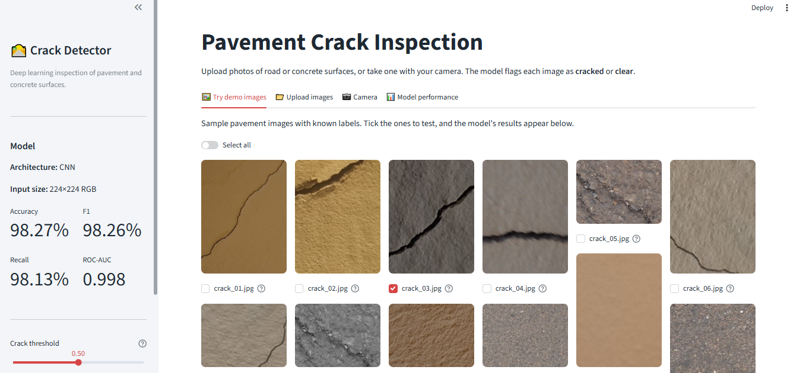
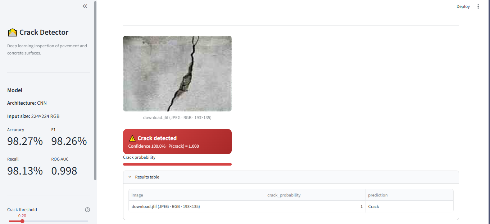
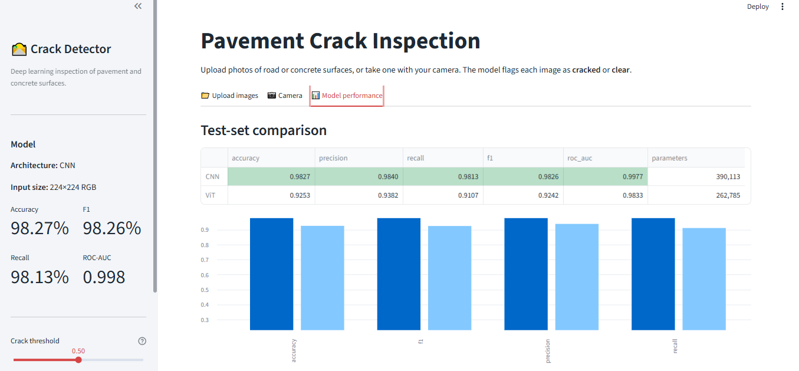

# 🛣️ Pavement Crack Detection: CNN vs Vision Transformer

Deep learning system that classifies photos of road and concrete surfaces as **cracked** or **clear**. Two models, a **CNN** and a **Vision Transformer (ViT)**, were trained from scratch on 30,000 images and compared. The winning CNN (**98.27% test accuracy**) is served through an interactive **Streamlit** web app.

📓 **Training notebook (Google Colab):** [Open in Colab](https://colab.research.google.com/drive/15neVKUK5pRW2Jf3wApN3skVxvVIBBprz?usp=sharing)



## Results

Test set: 4,500 unseen images (2,250 per class).

| Model | Accuracy | Precision | Recall | F1-score | ROC-AUC | Parameters |
|---|---|---|---|---|---|---|
| **CNN** ✅ | **0.9827** | **0.9840** | **0.9813** | **0.9826** | **0.9977** | 390,113 |
| ViT | 0.9253 | 0.9382 | 0.9107 | 0.9242 | 0.9833 | 262,785 |

The CNN misclassified only **78 of 4,500** test images (36 false alarms, 42 missed cracks). The ViT misclassified 336. CNNs are built to detect local patterns such as thin crack lines, while a ViT trained from scratch needs far more data or pre-training to compete.

| Prediction on a web photo (not from the dataset) | Model performance tab |
|---|---|
|  |  |

## App features
- **Demo gallery:** 15 sample images with known labels. Tick any of them to see the prediction next to the correct answer.
- **Upload any image format:** JPG, PNG, WEBP, HEIC (iPhone), TIFF, BMP, GIF, AVIF, JPEG 2000, as well as grayscale, CMYK, 16-bit and transparent images. Each one is automatically converted to 8-bit RGB and resized to 224×224. Files that aren't images are skipped with a warning.
- **Camera input**, an adjustable **crack threshold**, result cards with confidence, and a **CSV download** of predictions.
- A **Model performance** tab comparing the CNN and the ViT.

## Pipeline (notebook)
1. **Data loading:** the Kaggle dataset [`oluwaseunad/concrete-and-pavement-crack-images`](https://www.kaggle.com/datasets/oluwaseunad/concrete-and-pavement-crack-images) is downloaded with `kagglehub`: 30,000 images, 15,000 per class.
2. **Preprocessing:** integrity check, stratified 70/15/15 split, class weights, and a `tf.data` pipeline (resize 224, cache, prefetch).
3. **EDA:** class balance, sample grid, brightness and contrast statistics, mean images.
4. **Feature engineering:** Sobel edge analysis, and data augmentation (flip, rotation, zoom, contrast, brightness).
5. **Models:**
   - **CNN:** 4 Conv-BN-ReLU-Pool blocks, global average pooling, dropout, sigmoid output.
   - **ViT:** 16×16 patches, position embedding, 6 Transformer blocks.
6. **Training:** AdamW, EarlyStopping, ReduceLROnPlateau, ModelCheckpoint (Colab T4 GPU).
7. **Evaluation:** learning curves, classification report, confusion matrix, ROC, error analysis.
8. **Export:** `crack_model.keras` and `model_info.json`.

## Project structure
```
├── app.py                  # Streamlit UI
├── utils.py                # model loading, any-format → RGB conversion, preprocessing (same as training)
├── model/
│   ├── crack_model.keras   # trained CNN (exported from the notebook)
│   └── model_info.json     # metrics, class names, input size, versions
├── demo_images/            # sample images for the demo tab (see CREDITS.md)
├── notebook/               # pavement_crack_detection.ipynb (training + results)
├── docs/                   # CEP report (.docx), presentation, report figures
├── images/                 # app screenshots
├── requirements.txt
├── Dockerfile              # optional: Docker / Hugging Face Spaces / Render
└── .streamlit/config.toml  # theme + upload limit
```

## Run locally (Windows)
```powershell
git clone https://github.com/TayyabXtreme/Prevent-Crack-Detection.git
cd Prevent-Crack-Detection
python -m venv venv
venv\Scripts\activate
pip install -r requirements.txt
streamlit run app.py
```
Open http://localhost:8501. On macOS or Linux, activate with `source venv/bin/activate`. Python 3.11 or 3.12 is required (TensorFlow 2.19 does not support 3.13 yet).

## Deploy on Streamlit Community Cloud (free)
1. Sign in at **https://share.streamlit.io** with the GitHub account that owns this repo.
2. Click **Create app**, then **Deploy a public app from GitHub**.
3. Fill in:
   - **Repository:** `TayyabXtreme/Prevent-Crack-Detection`
   - **Branch:** `main`
   - **Main file path:** `app.py`
   - **App URL:** pick a name, e.g. `pavement-crack-detection`
4. Open **Advanced settings** and set **Python version: 3.12**. This is required for TensorFlow.
5. Click **Deploy**. The first build takes about 3 to 5 minutes while TensorFlow installs. After that, every `git push` redeploys automatically.

## Alternative: Docker (Hugging Face Spaces, Render, any server)
```bash
docker build -t crack-detector .
docker run -p 8501:8501 crack-detector
```
On **Hugging Face Spaces**, create a Space with the **Docker** SDK, push this repo to it, and add `app_port: 8501` to the Space's README header.

## Retrain the model
Open the [Colab notebook](https://colab.research.google.com/drive/15neVKUK5pRW2Jf3wApN3skVxvVIBBprz?usp=sharing), choose *Runtime → Change runtime type → T4 GPU*, then *Run all*. The last cell downloads `crack_model_export.zip`. Unzip it into `model/` and push.

## Tech stack
TensorFlow / Keras 3 · Streamlit · scikit-learn · Pillow + pillow-heif · pandas · NumPy · Matplotlib / Seaborn · Google Colab

**Team:** 23BSAI048, 23BSAI001, 23BSAI006. Artificial Neural Network CEP.
